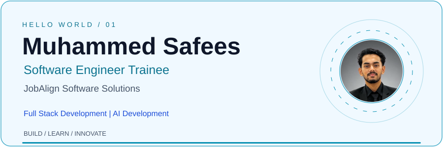
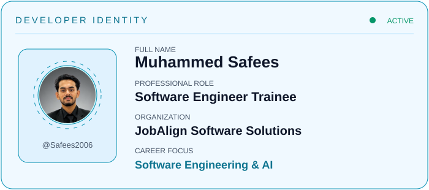
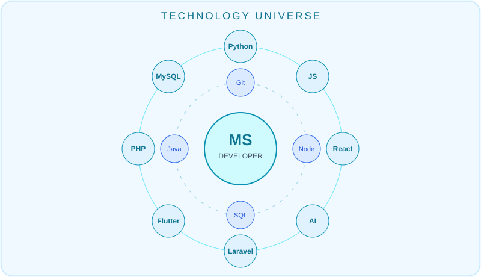
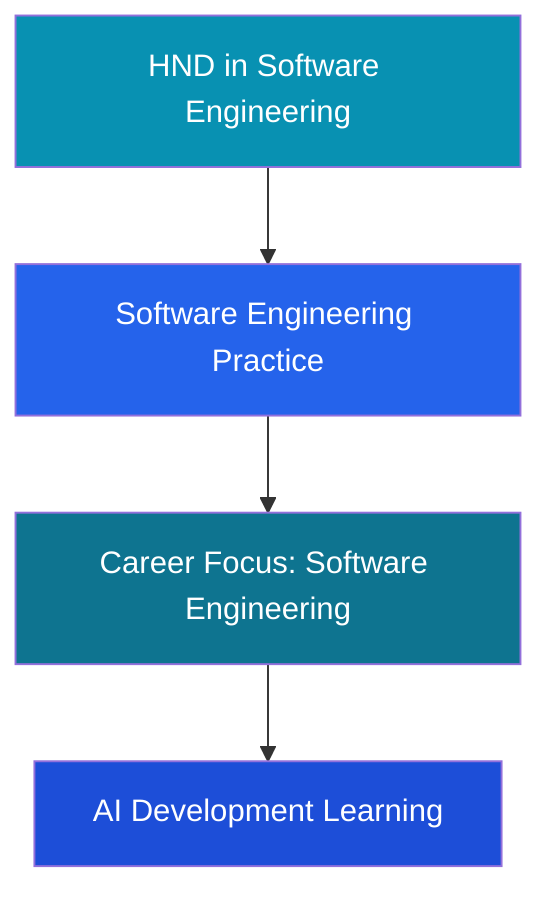
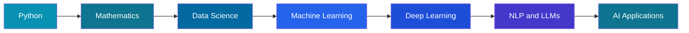

<!-- ================= HERO BANNER ================= -->

<div align="center">
  <picture>
    <source media="(prefers-color-scheme: dark) and (prefers-reduced-motion: reduce) and (max-width: 600px)" srcset="assets/dark/hero-mobile-static.svg">
    <source media="(prefers-color-scheme: light) and (prefers-reduced-motion: reduce) and (max-width: 600px)" srcset="assets/light/hero-mobile-static.svg">
    <source media="(prefers-color-scheme: dark) and (prefers-reduced-motion: reduce)" srcset="assets/dark/hero-static.svg">
    <source media="(prefers-color-scheme: light) and (prefers-reduced-motion: reduce)" srcset="assets/light/hero-static.svg">
    <source media="(prefers-color-scheme: dark) and (max-width: 600px)" srcset="assets/dark/hero-mobile.svg">
    <source media="(prefers-color-scheme: light) and (max-width: 600px)" srcset="assets/light/hero-mobile.svg">
    <source media="(prefers-color-scheme: dark)" srcset="assets/dark/hero.svg">
    <source media="(prefers-color-scheme: light)" srcset="assets/light/hero.svg">
    
  </picture>
</div>

<!-- ================= TYPING ANIMATION ================= -->

<div align="center">


<br/>


<br/>

[](https://github.com/Safees2006)
[](https://www.linkedin.com/in/muhammed-safees)
[](mailto:muhammedsafees54@gmail.com)
[](https://www.instagram.com/safees_.s/)

</div>

---

<!-- ================= SNAKE CONTRIBUTION ================= -->

## 🐍 Contribution Snake

<div align="center">
  <picture>
    <source media="(prefers-color-scheme: dark)" srcset="https://raw.githubusercontent.com/Safees2006/Safees2006/output/github-snake-dark.svg">
    
  </picture>
</div>

---

<!-- ================= ABOUT ME ================= -->

## 🌟 About Me


- 👨‍💻 **Software Engineer Trainee**
- 💼 Currently working at **JobAlign Software Solutions**
- 🎓 HND in Software Engineering
- 🌍 Based in Sri Lanka
- 💻 Interested in Full Stack Software Development
- 🤖 Exploring Artificial Intelligence and Machine Learning
- 🚀 Passionate about building practical software solutions
- 🌱 Continuously learning modern technologies
- 🎯 Career focus: Software Engineering & AI Development
- 📧 Reach me at **muhammedsafees54@gmail.com**

<br clear="right"/>

---

<div align="center">
  
</div>

<!-- ================= DEVELOPER CARD ================= -->

## 🪪 Developer Identity

<div align="center">
  <picture>
    <source media="(prefers-color-scheme: dark)" srcset="assets/dark/developer-card.svg">
    
  </picture>
</div>

---

<!-- ================= CURRENT WORK ================= -->

## 🧠 Currently Working On

```text
💼  Software Engineering at JobAlign Software Solutions
💻  Full Stack Web Application Development
⚙️  Laravel, React and modern web technologies
🤖  Exploring Artificial Intelligence
📚  Improving software engineering knowledge
🚀  Building practical real-world applications
```

---

<!-- ================= STRENGTHS ================= -->

## 🧩 Strengths Snapshot

<div align="center">

| 💻 Development | 🧠 Problem Solving | 🔗 APIs | 🤝 Teamwork | 🤖 AI |
|:---:|:---:|:---:|:---:|:---:|
| Full Stack | Logical Thinking | Integration | Collaboration | Continuous Learning |

</div>

---

<!-- ================= TECH ORBIT ================= -->

## 🌐 Technology Universe

<div align="center">
  <picture>
    <source media="(prefers-color-scheme: dark)" srcset="assets/dark/tech-orbit.svg">
    
  </picture>
</div>

---

<!-- ================= TECH STACK ================= -->

## 🧰 Technologies & Tools

<div align="center">

### Programming Languages


### Frontend Development


### Backend Development


### Databases


### Mobile Development


### Artificial Intelligence — Learning


### Development Tools


</div>

---

<!-- ================= EXPERIENCE ================= -->

## 💼 Professional Experience

### Software Engineer Trainee

**JobAlign Software Solutions**

`Current Role`

- Software application development
- Full stack web development
- Frontend and backend integration
- Working with modern development technologies

---

<!-- ================= EDUCATION ================= -->

## 🎓 Education



---

<!-- ================= PROJECTS ================= -->

## 📂 Featured Projects

<table>
<tr>
<td width="50%">

### 📚 Library Management System

A library management application with book management, borrowing and inventory features.

**Laravel · MySQL · Bootstrap**

</td>
<td width="50%">

### 🎓 Learning Management System

A course management platform with administrator and student dashboards.

**Laravel · React · Inertia.js**

</td>
</tr>
<tr>
<td width="50%">

### 🌱 Mahangu Guard — Smart Agriculture

An IoT prototype exploring simulated agricultural monitoring.

**Python · Flask · IoT · Wokwi**

</td>
<td width="50%">

### 🌍 Enviro Wise

An environmental data science application for data analysis and visualization.

**PHP · MySQL · JavaScript**

</td>
</tr>
<tr>
<td width="50%">

### 🖥️ Personal Portfolio Website

A professional portfolio showcasing projects and technical interests.

**Web Development**

</td>
<td width="50%">

### ⚙️ Forkticks

A software project involving frontend and backend integration.

**Laravel · React**

</td>
</tr>
</table>

<div align="center">

[](https://github.com/Safees2006?tab=repositories)

</div>

---

<!-- ================= AI ROADMAP ================= -->

## 🤖 AI & Machine Learning Roadmap



---

<!-- ================= GOALS ================= -->

## 🎯 2027 Career Goals

Suggested learning and professional development roadmap.

- [ ] Strengthen Full Stack Software Development skills
- [ ] Improve Data Structures and Algorithms
- [ ] Learn Machine Learning fundamentals
- [ ] Explore Deep Learning, NLP and LLMs
- [ ] Build AI-powered software applications
- [ ] Explore Cloud Computing and DevOps
- [ ] Contribute to open-source projects
- [ ] Build a professional project portfolio

---

<!-- ================= GITHUB ANALYTICS ================= -->

## 📊 GitHub Analytics

<div align="center">

<picture>
  <source media="(prefers-color-scheme: dark)" srcset="https://github-readme-stats.vercel.app/api?username=Safees2006&show_icons=true&theme=tokyonight&hide_border=true">
  
</picture>

<picture>
  <source media="(prefers-color-scheme: dark)" srcset="https://streak-stats.demolab.com?user=Safees2006&theme=tokyonight&hide_border=true">
  
</picture>

<br/>

<picture>
  <source media="(prefers-color-scheme: dark)" srcset="https://github-readme-stats.vercel.app/api/top-langs/?username=Safees2006&layout=compact&theme=tokyonight&hide_border=true&langs_count=10">
  
</picture>

</div>

---

## 📈 Contribution Activity Graph

<div align="center">

<picture>
  <source media="(prefers-color-scheme: dark)" srcset="https://github-readme-activity-graph.vercel.app/graph?username=Safees2006&theme=tokyo-night&hide_border=true">
  
</picture>

</div>

---

## 🏆 GitHub Trophies

<div align="center">

<picture>
  <source media="(prefers-color-scheme: dark)" srcset="https://github-profile-trophy.vercel.app/?username=Safees2006&theme=tokyonight&no-frame=true&column=6">
  
</picture>

</div>

---

<!-- ================= BADGES ================= -->

## 🏅 GitHub Community

<div align="center">

[](https://github.com/Safees2006)
[](https://github.com/Safees2006?tab=followers)

</div>

---

<!-- ================= SOCIAL LINKS ================= -->

## 🌐 Let's Connect

<div align="center">

[](https://github.com/Safees2006)
[](https://www.linkedin.com/in/muhammed-safees)
[](mailto:muhammedsafees54@gmail.com)
[](https://www.instagram.com/safees_.s/)
[](https://web.facebook.com/muhammed.safees.2025)

</div>

<!-- ================= CLOSING QUOTE ================= -->

<div align="center">


<br/>

**Thanks for visiting my profile!**


</div>
